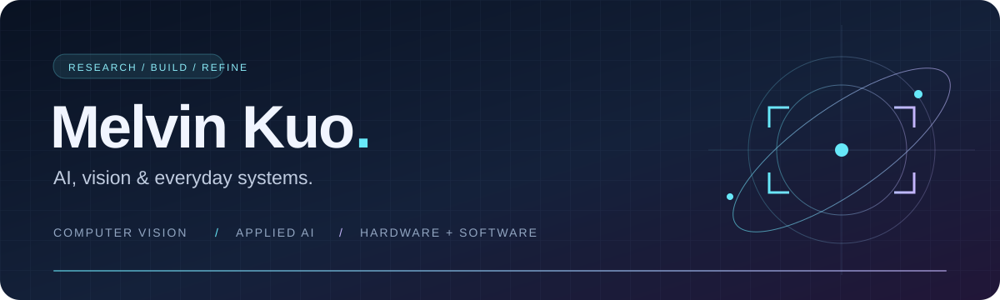

**把 AI 接上真實生活，把想法做成能用的系統。**

Computer Vision · Applied AI · Smart Home · Hardware & Software

[關於我](#-about-me) · [研究方向](#-research-focus) · [精選專案](#-selected-projects) · [技術工具](#-languages--tools)

## 👋 About Me

我是 **Melvin Kuo**，學術背景來自國立臺北科技大學電機工程與淡江大學。關注電腦視覺、影像分割與 AI 模型部署，也喜歡把模型、網頁與硬體串在一起，解決日常使用中的問題。

近期作品從 **Discord AI 助理**、**智慧家庭平台**，延伸到 **水冷 LCD 音樂介面**與 **macOS 電池監控專案貢獻**。除了功能，我也在意介面、部署流程，以及系統真正跑起來之後的細節。

> 磨練是進步的養分，堅持會開花結果。

## 🧠 Research Focus

| 方向 | 關注的問題 |
| :--- | :--- |
| **Computer Vision & Segmentation** | 語意分割、語言引導的互動式影像與影片物件分割。 |
| **Efficient AI & Edge Deployment** | 小型語言模型、TensorRT 與推論優化，探索邊緣設備上的互動應用。 |
| **Applied AI** | 以影像辨識探索污水管異常檢測，連接模型能力與實際維護需求。 |
| **LLM Applications** | 對話記憶、工具呼叫、文件處理，以及本機與雲端模型整合。 |

## 🚀 Selected Projects

### 🦆 [呱呱 · Discord AI Assistant](https://github.com/melvin0kuo/DISCORD-BOT)

**一隻住在 Discord，會聊天、讀文件，也陪你聽音樂的多功能鴨子。**

- **系統架構**：Python / discord.py 串接 LM Studio 或 Gemini，搭配 SQLite、語義記憶與本機 Lavalink。
- **核心功能**：文件摘要、附來源的網路搜尋、自然語言點歌，以及對話脈絡保存。
- **使用體驗**：Windows 本機部署工作台，逐步設定模型、搜尋與音樂服務。

`Python` `LLM Tool Calling` `Gemini` `LM Studio` `SQLite` `Lavalink`

---

### 🔋 [macbookBatteryMonitor · macOS 電池與系統監控](https://github.com/melvin0kuo/macbookBatteryMonitor)

**Contributor · 參與改善 macOS 選單列電池監控的功耗資訊與操作介面。**

- **專案用途**：在 macOS 選單列查看電量、電池健康度、剩餘時間與硬體功耗。
- **我的貢獻**：動畫電力流向、分層硬體功耗、功率感測備援、選單列圖示內百分比與滿電穩定顯示。
- **進階功能**：參與管理員 CPU 功耗取樣功能；貢獻紀錄見[上游專案致謝](https://github.com/sgeric910601/macbookBatteryMonitor#致謝)。

`Contributor` `macOS` `Swift` `SwiftUI` `Power Monitoring`

---
### 🏠 [Smart Home Hub · 繁體中文智慧家庭平台](https://github.com/melvin0kuo/smart-home-hub)

**讓裝置狀態、房間與控制操作，集中在適合日常使用的介面。**

- **系統架構**：React + TypeScript 前端、FastAPI 後端，透過 Home Assistant REST / WebSocket 整合設備。
- **核心功能**：裝置與房間管理、狀態同步、攝影機串流代理，以及可選的米家香氛機 BLE 整合。
- **開發方式**：提供 Mock Mode 與角色權限；實機控制依設備映射和能力驗證開放。

`React` `TypeScript` `FastAPI` `Home Assistant` `WebSocket` `BLE`

---

### 🎵 [Apple Music AIO · 水冷螢幕上的音樂風景](https://github.com/melvin0kuo/apple-music-aio)

**為 NZXT Kraken / Elite LCD 打造的 Apple Music 播放資訊介面。**

- **系統架構**：Python 本機服務讀取 Windows SMTC 媒體資訊，交由網頁呈現。
- **視覺設計**：流體極光、專輯封面光暈、歌曲跑馬燈與圓形螢幕適配。
- **日常使用**：顯示歌曲、歌手與播放進度，閒置時切換時鐘，無需 Apple Music 開發者 API 金鑰。

`Python` `Windows SMTC` `HTML` `CSS Animation` `JavaScript`

## 🛠️ Contributions & Hardware Notes

| 專案 | 我的參與／整理內容 |
| :--- | :--- |
| 🖥️ [Raspberry Pi LCD BootUp Solution](https://github.com/melvin0kuo/RaspberryPi-LCD-BootUp-Solution) | 整理 Raspberry Pi 3、Bookworm 64-bit 與 3.5 吋 SPI 觸控螢幕的驅動、開機與 Xorg 問題排解。 |

## ⚙️ Languages & Tools

**Languages & Web**

**AI & Data**

**Tools & Integration**

<strong>🌏 English · About me</strong>

My academic background is in electrical engineering at National Taipei University of Technology and Tamkang University. My interests include computer vision, semantic segmentation, language-guided video segmentation, and efficient AI deployment.

I also build practical systems: a Discord assistant with local/cloud LLMs, a Traditional Chinese smart home dashboard, and an Apple Music display for AIO cooler screens. I have contributed power monitoring and interface improvements to an upstream macOS battery monitoring project.

I enjoy connecting AI, software, and hardware—and working through the details that make a project useful beyond a demo.

<strong>🔧 Beyond code · 硬體與維修</strong>

喜歡探索電腦軟硬體，持有淡江大學電腦維修隊中級維修證照。從電腦維修、樹莓派螢幕到智慧家庭整合，持續把軟體能力延伸到實體設備。

---

**一起聊聊 AI、影像研究，或下一個有趣的軟硬體專案。**

[Email](mailto:melvin0kuo@gmail.com) · [LinkedIn](https://www.linkedin.com/in/melvin0kuo/) · [GitHub](https://github.com/melvin0kuo)

From pixels to practical systems.

